<div align="center">



<p>
  <a href="#-sobre-mí">Sobre mí</a> ·
  <a href="#-proyectos">Proyectos</a> ·
  <a href="#-stack-tecnológico">Stack</a> ·
  <a href="#-mi-setup">Setup</a> ·
  <a href="#-github-en-números">Stats</a> ·
  <a href="#-hablemos">Contacto</a>
</p>

</div>

## 👤 Sobre mí

Soy un desarrollador con ojo de diseñador. Me especializo en crear experiencias visuales fluidas y sistemas robustos. Mi día a día transcurre entre terminales personalizadas de **Arch Linux**, compilaciones en **Rust** y el diseño de interfaces dinámicas con **QML**.

- 🎓 **Academia:** Lic. en Gestión y Desarrollo de Tecnología. Cursando la **Maestría en Diseño Multimedia**, con hambre de seguir aprendiendo: al terminar, directo al **Doctorado**.
- 🛠 **Actualmente:** liderando **The-Gekko | Soluciones Tech** y su ecosistema de herramientas para Linux.
- 🧪 **Testing:** colaboro activamente testeando aplicaciones para la comunidad de desarrolladores.
- 🎨 **Pasión:** la personalización extrema de entornos (dotfiles) y el diseño multimedia.
- 🐢 **Comunidad:** Líder Técnico de «las tortugas de ezku».
- 🎖️ **Comunidad:** Manager de «Helldivers 2 elit latinamerica».



## 🚀 Proyectos

Todo lo que construyo forma un mismo ecosistema: **GekkoApp** es el Control Center que instala, actualiza y desinstala el resto desde una sola interfaz.

<p align="center">
  <a href="https://github.com/The-Gekko/GekkoApp"></a>
  <a href="https://github.com/The-Gekko/Nitro-Gekko"></a>
  <a href="https://github.com/The-Gekko/The-Gekko-Bauh"></a>
  <a href="https://github.com/The-Gekko/gekko-adb"></a>
</p>

**Pruébalo:** instala GekkoApp desde su último release verificado (Arch Linux, Garuda o Solus):

```bash
curl -fsSL https://raw.githubusercontent.com/The-Gekko/GekkoApp/main/scripts/install-release.sh | bash
```


## 🧰 Stack tecnológico



## 💻 Mi setup




## 📊 GitHub en números

<p align="center">
  
  
</p>

<picture>
  <source media="(prefers-color-scheme: dark)" srcset="https://raw.githubusercontent.com/The-Gekko/The-Gekko/output/snake-dark.svg"/>
  <source media="(prefers-color-scheme: light)" srcset="https://raw.githubusercontent.com/The-Gekko/The-Gekko/output/snake.svg"/>
  
</picture>

## 📬 Hablemos

<p align="center">¿Tienes un proyecto en mente? Escríbeme.</p>

<p align="center">
  <a href="mailto:anyaspy5426@gmail.com"></a>
  &nbsp;
  <a href="https://discordapp.com/users/thegekko5"></a>
</p>

<br/>



<!--
  Los SVG de assets/ se generan con:  python3 scripts/build_assets.py
  Las estadísticas y la snake las publica la Action «Perfil · estadísticas y snake»
  (.github/workflows/profile.yml) en la rama `output`.
-->
